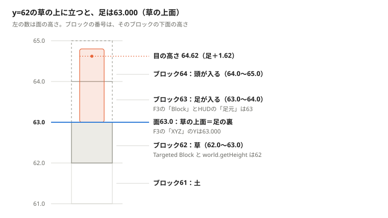
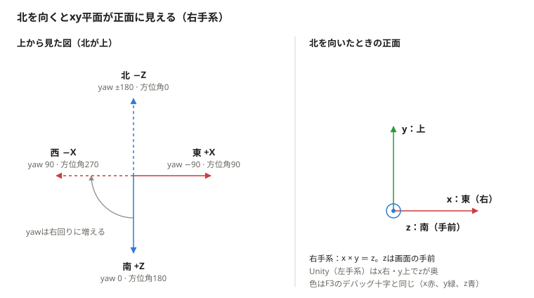
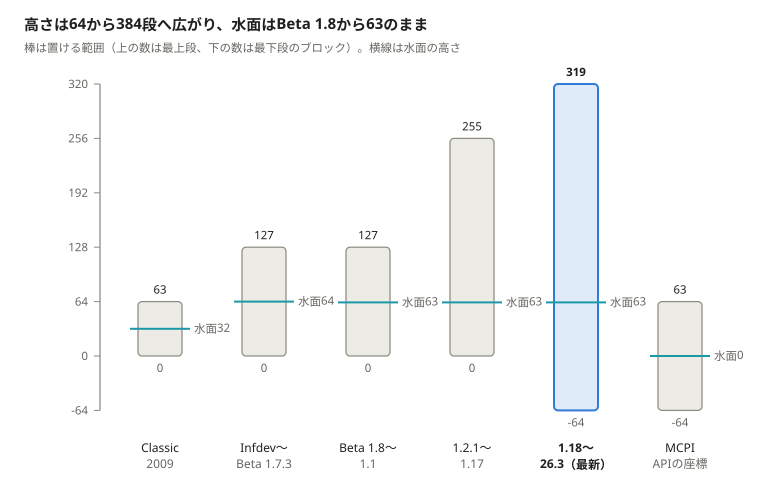

# マイクラの座標・方位・高度

マイクラの座標は「ブロックは幅1の区間、プレイヤーは足の裏の一点」と読むと、F3の表示、海面、API、マイクラリモコンの値がすべてそろう。この文書は、本家の歴史と最新版を突き合わせ、次に最新版とマイクラリモコンを突き合わせる。

- 最新版：Java Edition 26.3。McRemoteの対応版は、最新版（今は26.3）と1.21.11の2本（`2026-11-19-03`）
- 世界定数の実値は[世界定数](world-constants-facts_ja.md)が正本で、この文書は値の意味を説明する
- マイクラリモコンの側は、このrepoのmain `4187bee`（2026-11-19）で読んだ。本家の事実は末尾の出典の頁による
- Unity箱庭は扱わない。Unityは左手系で、今の箱庭（`mc-remote-unity-sandbox` `d3539c3`）はMinecraftの座標をそのまま写しているので、鏡像になっている。human ownerが「方位がおかしい」と気づいたのがきっかけで、これから直してマイクラリモコンに合わせる（[19-unity](../19-unity/README_ja.md)）

## 1. 基本：ブロックは区間、プレイヤーは点

y=62のブロックは高さ62.0〜63.0を占め、その上に立つプレイヤーのyは63.000になる。ブロックの番号（下面）と上面の高さが1ずれることが、混乱のほとんどの元である。



番号62の草ブロックは62.0〜63.0を占め、その上面63.0に足の裏が乗る。F3の「Block」は足の入る63を、照準は草の62を指す。

- ブロックの座標：そのブロックの北西・下の角。小数の座標を切り下げ（floor）て求めるので、負の側は-1から数える（x=-0.5はブロック-1）。y=0のブロックは底面0.0、上面1.0
- ブロックの中心：各軸に+0.5。`/tp 100 64 -200`はxとzだけブロックの中央へ寄せ、yは足の高さとしてそのまま使う
- プレイヤーの座標：当たり判定の底面の中心、つまり足の裏。目は足の1.62上。当たり判定は幅0.6、高さ1.8で、スニークすると1.5になる（Java 1.14から、統合版1.19.70から）
- 上面が欠けたブロックの上では、足のyが小数になる。ハーフブロックなら63.5で、F3のBlockは63のまま

F3の各行の意味（最新版）：

| 行 | 何を示すか |
| --- | --- |
| XYZ | 足の位置。小数3桁 |
| Block | 足が入っているブロックの座標。「立っているブロック」ではない |
| Facing | 向いている方角、軸（Towards negative Zなど）、yawとpitch |
| Targeted Block | 照準が当たっているブロックの座標。そのブロックはy〜y+1を占める |

## 2. 方位と回転：右手系と北向きの標準

Minecraftは右手系で、北を向くとxy平面が正面に見える（xは右＝東、yは上、zは手前＝南）。マイクラリモコンはこの向きを標準とする（`2026-11-20-01`）。数学やOpenGLでzを画面の手前に取る見え方と同じである。



上から見ると、南が+Zでyawは0、右回りに西90、北±180と増える。北を向くとxが右、yが上、zが手前になり、xy平面がそのまま見える。

- yawは南を0とし、右へ回ると増える。pitchは+90が真下、−90が真上
- 方位角（北を0として時計回り）は、yaw+180を360で割った余り。McRemoteのHUDの方位の色相（北0°→東90°→南180°→西270°）はこの方位角
- 右手系：東（x）×上（y）＝南（z）。そのため、コマンドのローカル座標`^`では+Xが左を向く。F3のデバッグ十字はx赤、y緑、z青
- Unityは左手系（x右、y上、z前）。座標をそのまま写すと、数値と方位の表示は合っても、見え方が左右反転する

向きの単位ベクトル（ψ：yaw、θ：pitch）：

```latex
\vec{d} = \left(-\sin\psi\cos\theta,\ -\sin\theta,\ \cos\psi\cos\theta\right)
```

## 3. 本家の歴史と最新版

軸の向きと「ブロックは区間」という数え方は、最初から変わっていない。変わったのは、高さの範囲、海面、F3のYが足か目か、太陽の昇る方角（つまり方角の名前）である。



置ける範囲は、Classicの64段から1.18の384段まで広がった。水面はBeta 1.8で64から63に下がり、それからは変わっていない。MCPIのAPIは、水面をy=0に置く。

| 項目 | 歴史 | 最新版（26.3） |
| --- | --- | --- |
| 高さ（置ける範囲） | Classicは高さ64。Infdev 20100227-1414で128（0〜127）。1.2.1（12w07a、Anvil）で0〜255。1.18で-64〜319 | -64〜319。足の上限は320 |
| 海面 | Infdevの途中で65→64。Beta 1.8のプレリリースで、水の最上段が63→62（水面は64→63） | 水の最上段は62、水面は63。生成設定の`sea_level`は63 |
| 高さの数え方 | — | wikiはブロックの下面で数え（海面62）、上面でも数える（海面63）。F3の値は上面の数え方 |
| 海面の決め打ち | `sea_level`を変えても、63を前提にする箇所が残っていた | 24w33aで直った |
| スーパーフラットの海面 | 1.21.3のころから-63になるバグ（MC-278019） | 直ったかは未確認 |
| F3のY | 最初期は目の高さ（65.620）。1.7.10までは目の位置も並べて出し、1.8から足だけ | XYZは足、Blockは足の入るブロック。1.21.9から表示する項目を選べる |
| 太陽と方角の名前 | Indevから、太陽は北（-Z）から昇った。昇る方を東と呼ぶと名前が90°ずれ、+Xと+Zへの偏りを「南西ルール」と呼んだ | Beta 1.9 Prerelease 4（1.0.0）から東（+X）から昇る。同じ偏りは「南東ルール」 |
| 統合版（旧Pocket Edition） | v0.1.0は高さ127。v0.9.0で水の最上段が63→62。1.1.0で太陽が東から昇るようになった。beta 1.2.0.31で座標表示を追加 | 軸と方位はJavaと同じ。下端は-64。座標表示は整数のブロック位置 |
| Bukkitの`getHighestBlockYAt` | 長く「最上のブロックの1つ上（空気）」を返し、2016年にdocをその挙動に合わせた。1.14〜1.15のころに挙動が変わった | 「最も高い、空でない（通れない）ブロック」のy |

### 3.1 MCPIのころ（Pi Edition、mcpi、RaspberryJuice）

Pi EditionのAPIはスポーン地点からの相対で、y=0が海面に当たる。Bukkitで同じAPIを出すRaspberryJuiceは、原点がスポーン地点でyも含むので、y=0の意味が違う。

| 項目 | Pi Edition（本体のAPI） | mcpi（Python） | RaspberryJuice（Bukkit） |
| --- | --- | --- | --- |
| 原点 | スポーン地点の海面 | — | スポーン地点（yも含む）。ABSOLUTEでは(0,0,0) |
| 世界 | 256×256×128（Pocket Edition 0.6.1が基） | — | Bukkitの世界 |
| ブロック座標の丸め | — | `math.floor`してから送る | 受けた値を`(int)`で0の側へ切る |
| `getTilePos` | 「最も近いブロック」とだけ書かれている | サーバーの整数をそのまま | 足の位置をfloor＝足の入るブロック。床はy−1 |
| `getHeight` | 上から見て最後の固くないブロックのy（地面かその上の空気かは文書から決まらない） | floorして送る | `getHighestBlockYAt`−原点のy。Bukkitの版で意味が変わる |
| `getRotation` | — | floatで受ける | 負のyawに−1を掛ける。yawが−180〜180なら、東（−90）が90（西）になる |
| 方角の名前 | 文書はXが南、Zが西（太陽が北から昇ったころの呼び方） | — | — |

RaspberryJuiceは`e8ef1bc`、mcpiは`91769a2`のコードを読んだ結果である。

## 4. 最新版とマイクラリモコンの突き合わせ

本家とマイクラリモコンは同じ面を指していて、違うのは名前と範囲の端の含み方だけである。たとえば本家の海面63と`y_sea`=62は同じ水面を指し、本家の`getSeaLevel()`（63）はマイクラリモコンの`y_ground`に当たる。

| 項目 | Minecraft 26.3（本家、Paper） | マイクラリモコン |
| --- | --- | --- |
| 置ける高さ | -64〜319。Paperの`getMinHeight()`は-64、`getMaxHeight()`は320で上端を含まない | `Y_MIN`=-64、`Y_MAX`=319で両端を含む。外は`out_of_bounds` |
| 足の範囲 | 319のブロックの上に立つと足は320 | `y_steve_min`=-64、`y_steve_max`=320（`y_max`+1） |
| 海面 | 水の最上段は62、水面は63。`getSeaLevel()`は63 | `world_constants.y_sea`=62＝`getSeaLevel()`−1。座標の式には使わない |
| 地面に立つ足 | 海面の高さの地面に立つと、足は63.000 | `y_ground`=63（＝`getSeaLevel()`） |
| 雲 | 雲の底面は192.33（26.xのdimension typeの`minecraft:visual/cloud_height`）。ブロック192は雲と重なり、雲に触れない最上段の空気は191。wikiは下面の数え方で191、上面の数え方で192 | `y_cloud`=192（厚さ4の雲の最下段のブロック）。雲の底面192.33はブロック192の中にあり、意図どおり（human owner 2026-11-20） |
| ネザー | 溶岩の海の`sea_level`は32（溶岩は31まで） | `y_lava`=31、`y_ground`=32。26.3で、溶岩は31までで、岸に立つとHUDの足元は32だった（human owner 2026-11-20） |
| ブロックの座標 | 整数。北西・下の角 | `world.*`のx、y、zはbuild originからの整数の差。絶対＝origin＋差で、暗黙のYのずらしはない。既定のoriginは(200, 0, 200)。Scratchはoriginのyを0で固定 |
| 足の位置 | `getLocation()`は足、double | `player.getPos`／`getPose`はoriginからの足の位置。小数3桁へHALF_UP、-0は0 |
| yawとpitch | yawは南0で右回りに増える。pitchは+90が下 | yawは[-180, 180)へ正規化して小数2桁。pitchは-90〜90で、外は`invalid_params` |
| 向き | `getDirection()`は単位ベクトル | `DirectionValue`＝[x, y, z]を正規化。小数6桁 |
| 地面の高さ | `getHighestBlockYAt`は最も高い、空でないブロック | `world.getHeight`は「上が通れる、通れないブロック」の相対のy。つまり地面のブロック |
| 座標の表示 | F3：XYZ（足）、Block（足の入るブロック）、Targeted Block | HUD：足元（足の位置を含むブロック）か照準（16ブロック以内、液体とentityは除く）。各軸をfloorし、相対＝対象−原点 |
| 方位の表示 | F3のFacing：4方位と軸 | HUD：8方位（北〜北西、N〜NW）。色相は方位角 |
| 統合版 | 座標表示は整数のブロック位置。通信の中ではプレイヤーの位置は目の高さで、Geyserが1.62を引いて足に直す | Geyserを通した統合版で、HUDの足元と統合版の座標表示が一致した（human ownerの観察、2026-11-20。統合版の版は未記録） |
| スーパーフラット | — | 非対応（`2026-07-30-02`） |
| MCPI | — | 世界定数の`mcpi`の行：`y_ground`=0、`y_sea`=-1、範囲-64〜63 |

マイクラリモコンの側の値は、[世界定数](world-constants-facts_ja.md)、wire（[wire-format-design](../10-protocol/wire-format-design_ja.md) §5）、HUD（[platform-design](../11-plugin/platform-design_ja.md) §11）、`y_sea`の定義（`2026-07-30-01`）による。

## 5. まだ確かめていないこと

本家とマイクラリモコンの値は、雲とネザーの溶岩まで照合できた。残るのは版の記録と、過去のAPIの細部である。

- 統合版：HUDが一致した観察に、統合版とGeyserの版を添える
- 26.4：snapshotでF3の見た目が変わっているので、26.4に対応するときに§1のF3の表を見直す
- スーパーフラットの海面のバグ（MC-278019）が26.3で直ったか
- MCPI：`player.getPos`のyが足か目か、`getHeight`が地面かその上の空気か。必要になったらMCPI-Rebornで試す
- Bukkitの`getHighestBlockYAt`の挙動が変わった正確な版
- Unity箱庭を右手系の見え方へ直し、マイクラリモコンに合わせる（記録は[19-unity](../19-unity/README_ja.md)）

## 出典

マイクラリモコン：このrepoのmain `4187bee`。旧APIのコード：[zhuowei/RaspberryJuice](https://github.com/zhuowei/RaspberryJuice)（`e8ef1bc`）、[martinohanlon/mcpi](https://github.com/martinohanlon/mcpi)（`91769a2`）。Unity箱庭：[Naohiro2g/mc-remote-unity-sandbox](https://github.com/Naohiro2g/mc-remote-unity-sandbox)（`d3539c3`）。

Minecraft Wiki（2025-11の写し）：

- [Coordinates（X y z）](https://wiki.ronlab.site/content/minecraftwiki_en_all_maxi_2025-11/X_y_z)
- [Debug screen](https://wiki.ronlab.site/content/minecraftwiki_en_all_maxi_2025-11/F3)
- [Altitude](https://wiki.ronlab.site/content/minecraftwiki_en_all_maxi_2025-11/Altitude)
- [Sun](https://wiki.ronlab.site/content/minecraftwiki_en_all_maxi_2025-11/Sun)
- [South-east rule](https://wiki.ronlab.site/content/minecraftwiki_en_all_maxi_2025-11/South-east_rule)
- [Pi Edition](https://wiki.ronlab.site/content/minecraftwiki_en_all_maxi_2025-11/Pi_v0.1.1)、[Pi Edition protocol](https://wiki.ronlab.site/content/minecraftwiki_en_all_maxi_2025-11/Pi_Edition_protocol)
- [Terrain](https://minecraft.wiki/w/Terrain)、[Noise settingsの既定値](https://minecraft.fandom.com/wiki/Custom)、[Sneak](https://minecraft.wiki/w/Sneak)、[Talk:Cloud（雲の高さ192.33）](https://minecraft.wiki/w/Talk:Cloud)

そのほか：

- [維度類型（dimension typeの`cloud_height`）](https://wiki.biligame.com/mc/%E7%BB%B4%E5%BA%A6%E7%B1%BB%E5%9E%8B)
- [mcpi protocol spec（Debianの写し）](https://sources.debian.org/src/minetest-mod-pycraft/0.22-4/mcpipy/mcpi/mcpi_protocol_spec.txt)
- [MC-273773（F3の目の位置）](https://bugs.mojang.com/browse/MC-273773)、[MC-226687（海面63の決め打ち）](https://bugs-legacy.mojang.com/browse/MC-226687)、[MC-278019（スーパーフラットの海面）](https://bugs.mojang.com/browse/MC-278019)
- [Paper Javadoc：Location](https://jd.papermc.io/paper/1.21.11/org/bukkit/Location.html)、[World](https://jd.papermc.io/paper/1.21.11/org/bukkit/World.html)
- [SPIGOT-2595](https://hub.spigotmc.org/jira/browse/SPIGOT-2595)、[SPIGOT-5523](https://hub.spigotmc.org/jira/browse/SPIGOT-5523)、[getHighestBlockのdocの修正（md_5）](https://ayakael.net/mirrors/papermc/commit/902b81e2ddad81da12d8ec154fc0ceedc620203b)
- Geyser：[統合版の位置から目の高さを引く](https://gitdab.com/CPU/Geyser/commit/357b681841bddec1f32d2791500a78df8e137319)、[PLAYERのoffset 1.62](https://gitdab.com/CPU/Geyser/commit/2a44874458fba950e9156aad479f604a9a4ba19a)
- [Minecraft Preview 1.19.70.20（統合版のスニーク）](https://windowscentral.com/gaming/minecraft/minecraft-preview-1197020-lets-players-be-more-sneaky)
- [/tpの座標（wikily.gg）](https://wikily.gg/minecraft/commands/coordinates)、[1.21.9以降のF3（space-node）](https://space-node.net/blog/minecraft-show-coordinates-server-2026)
- [Unity Manual：Rotation and orientation](https://docs.unity3d.com/Manual/QuaternionAndEulerRotationsInUnity.html)
